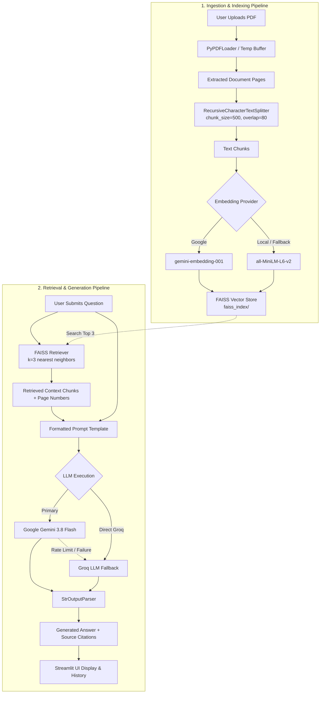

# 📄 PDF Q&A System using RAG (Retrieval-Augmented Generation)


An intelligent, multi-provider **Retrieval-Augmented Generation (RAG)** application built with **Streamlit**, **LangChain**, **FAISS**, **Google Gemini**, and **Groq**. Upload any PDF document, ask natural language questions, and receive context-grounded answers accompanied by exact source citations and page numbers.

---

## 📑 Table of Contents

- [💡 Why This Project Was Built](#-why-this-project-was-built)
- [✨ Key Features](#-key-features)
- [🏗️ System Architecture & Workflow](#️-system-architecture--workflow)
- [📁 Project Structure](#-project-structure)
- [⚙️ How It Works (Under the Hood)](#️-how-it-works-under-the-hood)
- [🚀 Quick Start & Installation](#-quick-start--installation)
- [🔑 Environment Variables Setup](#-environment-variables-setup)
- [🖥️ Running the Application](#️-running-the-application)
- [📖 Usage Guide](#-usage-guide)
- [🛠️ Configuration & Customization](#️-configuration--customization)
- [🛡️ Troubleshooting & Tips](#️-troubleshooting--tips)

---

## 💡 Why This Project Was Built

### The Problem
- **Information Overload:** Students, researchers, engineers, and enterprise professionals deal with massive PDFs daily (academic papers, legal contracts, technical manuals, financial statements).
- **Search Limitations:** Traditional keyword searches (`Ctrl + F`) fail when you don't know the exact phrasing, cannot synthesize insights across sections, and cannot summarize concepts.
- **LLM Context & Hallucination Risks:** Uploading full documents directly into standard LLMs often exceeds token limits, costs significant compute, or causes the model to "hallucinate" incorrect information not present in the document.
- **API Fragility & Quota Bottlenecks:** Real-world RAG apps frequently crash due to API rate limits (e.g., Google HTTP `429 Too Many Requests` or quota exhaustion).

### The Solution
This project implements **Retrieval-Augmented Generation (RAG)** to provide grounded, fact-based answers restricted to your PDF's contents:
1. **Strict Context Grounding:** The model answers queries using *only* semantic text chunks retrieved from the uploaded PDF, eliminating hallucinations.
2. **Resilient Multi-Provider Fallback Architecture:**
   - **Embeddings:** Supports Google Gemini Embeddings with an automatic, zero-key fallback to local CPU-based **Hugging Face (`all-MiniLM-L6-v2`)** if Google is rate-limited or unavailable.
   - **LLMs:** Queries execute on **Google Gemini (`gemini-3.8-flash`)** and seamlessly fail over to **Groq (`openai/gpt-oss-120b`)** without breaking the user session.
3. **Transparent Source Verification:** Every response links back to original text chunks with PDF page numbers so users can inspect and verify where the answer came from.

---

## ✨ Key Features

- 📑 **Instant PDF Ingestion:** Upload any PDF; it gets buffered in memory, extracted via `PyPDFLoader`, and indexed in seconds.
- 🧩 **Semantic Text Chunking:** Employs recursive character text splitting (`500` characters, `80` character overlap) to preserve semantic continuity across paragraph boundaries.
- ⚡ **Dual Vector Embedding Options:**
  - **Google Generative AI:** Cloud-based high-dimensional embeddings (`gemini-embedding-001`).
  - **Hugging Face Local:** Offline, 100% free CPU embeddings (`sentence-transformers/all-MiniLM-L6-v2`) requiring no API key.
- 🗄️ **Fast Local Vector Search:** Embedded chunks are stored and searched using Facebook AI Similarity Search (**FAISS**).
- 🔄 **Automatic LLM Failover:** LangChain LCEL pipeline featuring Gemini with Groq fallback. If Gemini hits quotas, Groq answers instantly with zero interruption.
- 🎯 **One-Click Quick Suggestions:** Built-in prompt chips to instantly generate comprehensive summaries, key takeaways, and main topics.
- 📜 **Interactive Q&A Session History:** Keeps track of past questions, answers, and source citations in expandable accordions.
- 🔍 **Source Attribution Viewer:** Inspect the exact text snippet and page number used to compose the response.
- 🎛️ **Sidebar Diagnostics:** Real-time visibility into active API keys, provider toggles, and vector store states.

---

## 🏗️ System Architecture & Workflow



---

## 📁 Project Structure

```text
PDF_QA_system_RAG/
│
├── app.py                      # Main Streamlit web application & UI logic
├── requirements.txt            # Python package dependencies
├── .env.example                # Template for required environment variables
├── .env                        # Local environment file (API keys - gitignored)
├── README.md                   # Comprehensive project documentation
│
├── src/                        # Modular RAG core engine
│   ├── __init__.py             # Python package marker
│   ├── loading.py              # Document loader (PyPDFLoader with temp buffering)
│   ├── splitting.py            # Text chunking (RecursiveCharacterTextSplitter)
│   ├── embedding.py            # Embedding generation & FAISS vectorstore management
│   ├── retriever.py            # Vector retriever configuration (k=3 similarity)
│   ├── llm.py                  # LLM setup (Gemini + Groq with LangChain fallback)
│   └── rag_chain.py            # LCEL RAG chain assembly and prompt formatting
│
└── faiss_index/                # Local serialized FAISS index storage
    ├── index.faiss             # FAISS binary vector index
    └── index.pkl               # Pickled chunk metadata and mappings
```

### Module Responsibilities

| File | Purpose |
| :--- | :--- |
| [`app.py`] | Renders the Streamlit frontend, manages session state (`db`, `qa_history`, `prefill_question`), handles document uploads, and coordinates user queries. |
| [`src/loading.py`] | Safely writes uploaded Streamlit bytes to a temporary directory and loads raw pages via `PyPDFLoader`. |
| [`src/splitting.py`] | Splits document pages into manageable semantic text chunks (`chunk_size=500`, `chunk_overlap=80`). |
| [`src/embedding.py`] | Embeds text chunks via Google or Hugging Face, builds the FAISS vector index, and saves it locally in `faiss_index/`. Includes automatic Google-to-HuggingFace fallback. |
| [`src/retriever.py`] | Converts the FAISS index into a similarity retriever configured to return the top `k=3` most relevant chunks. |
| [`src/llm.py`] | Configures Chat models (`ChatGoogleGenerativeAI`, `ChatGroq`). Implements `llm.with_fallbacks()` for zero-downtime inference. |
| [`src/rag_chain.py`] | Connects the retriever, custom context formatter (with page numbers), prompt template, and output parser into a unified LCEL pipeline. |

---

## ⚙️ How It Works (Under the Hood)

### 1. Document Loading & Temporary Storage
When a user uploads a PDF through the Streamlit interface, the file stream is saved to the operating system's temporary directory. `PyPDFLoader` from `langchain_community` parses the file, extracting text along with metadata (such as page numbers).

### 2. Chunking & Overlap
Large blocks of text cannot be directly converted into a single vector without losing granular semantic meaning. Using `RecursiveCharacterTextSplitter`:
- **`chunk_size=500`**: Keeps each segment focused on a specific point or paragraph.
- **`chunk_overlap=80`**: Retains sentence boundaries and prevents context from being severed across chunk edges.

### 3. Vector Embedding & FAISS Indexing
Each text chunk is transformed into a dense numerical vector:
- In **Auto Mode**, Google Gemini embeddings (`gemini-embedding-001`) are attempted first.
- If Google returns an API error or `429 Quota Exceeded`, the system gracefully shifts to the local `all-MiniLM-L6-v2` model from `sentence-transformers` on your CPU.
- Vectors and chunk metadata are saved to `faiss_index/` using **FAISS** (Facebook AI Similarity Search).

### 4. Similarity Search & Context Assembly
When a question is submitted:
- The question is converted into an embedding using the active embedding model.
- FAISS calculates cosine / L2 distance to find the **3 closest chunks (`k=3`)**.
- The chunks are formatted with clear page markers (`--- Context 1 (Page X) ---`).

### 5. Grounded Generation with Fallbacks
The system prompt strictly instructs the LLM:
> *"Provide clear, concise, and accurate answers based on the retrieved text. If the answer cannot be found in the context, truthfully state that the document does not contain that information."*

The formatted prompt is dispatched to **Google Gemini 3.8 Flash**. If an API issue occurs, LangChain's fallback mechanism automatically routes the request to **Groq (`openai/gpt-oss-120b`)** to deliver the answer without failing the user's query.

---

## 🚀 Quick Start & Installation

### Prerequisites
- **Python 3.10+** installed on your system.
- At least one valid API key:
  - [Google AI Studio Key](https://aistudio.google.com/) (`GOOGLE_API_KEY`)
  - [Groq Console Key](https://console.groq.com/) (`GROQ_API_KEY`)
  *(Optional: If no keys are provided, Hugging Face local embeddings can still be initialized on CPU).*

### 1. Clone the Repository
```bash
git clone https://github.com/jdevaiya/PDF_QA_system_RAG.git
cd PDF_QA_system_RAG
```

### 2. Create and Activate a Virtual Environment
```bash
# Windows (PowerShell)
python -m venv pdfenv
.\pdfenv\Scripts\activate

# macOS / Linux
python3 -m venv pdfenv
source pdfenv/bin/activate
```

### 3. Install Dependencies
```bash
pip install --upgrade pip
pip install -r requirements.txt
```

---

## 🔑 Environment Variables Setup

Create a `.env` file in the root directory by copying the example template:

```bash
# Windows
copy .env.example .env

# macOS / Linux
cp .env.example .env
```

Open `.env` and fill in your API credentials:

```ini
# Google Gemini API Key (https://aistudio.google.com/)
GOOGLE_API_KEY="AIzaSyYourActualGoogleKeyHere"

# Groq Cloud API Key (https://console.groq.com/)
GROQ_API_KEY="gsk_YourActualGroqKeyHere"

# Optional: HuggingFace API token (only if using private HuggingFace endpoints)
HUGGINGFACE_API_KEY="your_huggingface_api_key_here"
```

> [!NOTE]
> Hugging Face embeddings run completely locally on your CPU via `sentence-transformers` and do **not** require an API key or credit card.

---

## 🖥️ Running the Application

Launch the Streamlit web application:

```bash
streamlit run app.py
```

Once launched, open your web browser at:
```text
http://localhost:8501
```

---

## 📖 Usage Guide

1. **Check Status in Sidebar:**
   - Verify that your **Google Gemini** and/or **Groq** keys are displayed as `🟢 Configured`.
   - Choose your preferred **Embedding Provider** (`Auto`, `Google Gemini`, or `Hugging Face Local`).
   - Choose your preferred **LLM Provider** (`Auto`, `Google Gemini Only`, or `Groq Only`).

2. **Upload a PDF Document:**
   - In the **Upload Document** section, drag and drop or browse for a `.pdf` file.
   - The app will load, chunk, and embed the document automatically.

3. **Ask Questions:**
   - Click one of the **Quick Suggestion** buttons (`📌 Summarize this PDF`, `🔑 Key Takeaways`, `🔍 Explain Main Topics`) to populate common questions.
   - Or type any custom question into the text input box.
   - Click **🚀 Send Question**.

4. **Review Answers & Sources:**
   - View the synthesized answer.
   - Expand the **📚 View Retrieved Source Context Chunks** accordion to verify the exact text and page numbers from which the model drew its conclusion.
   - Scroll through **📜 Previous Questions & Answers** to review earlier queries in your session.

---

## 🛠️ Configuration & Customization

You can easily adapt the RAG pipeline parameters to fit your specific document types:

| Parameter | Location | Default | Description |
| :--- | :--- | :--- | :--- |
| **`chunk_size`** | [`src/splitting.py`] | `500` | Number of characters per text chunk. Increase (e.g., `800`-`1000`) for dense technical manuals. |
| **`chunk_overlap`** | [`src/splitting.py`] | `80` | Overlap between consecutive chunks to prevent lost context. |
| **`k` (Retrieved Chunks)** | [`src/retriever.py`] | `3` | Number of top matching chunks supplied to the LLM context. |
| **`temperature`** | [`src/llm.py`] | `0.3` | Controls randomness. Lower values (`0.0`-`0.3`) ensure factual, precise responses. |
| **`max_tokens`** | [`src/llm.py`] | `500` | Maximum length of generated answer tokens. |
| **Hugging Face Model** | [`src/embedding.py`] | `all-MiniLM-L6-v2` | Fast, lightweight 384-dimensional sentence transformer model. |

---

## 🛡️ Troubleshooting & Tips

- **Google API Quota Error (`RESOURCE_EXHAUSTED` / 429):**
  - Switch the **Embedding Provider** in the sidebar to `💻 Hugging Face (all-MiniLM-L6-v2 - Local & Free)`.
  - Set the **LLM Provider** to `🚀 Groq Only` or `⚡ Auto`.
- **FAISS Installation on Windows:**
  - If you encounter issues installing `faiss-cpu`, ensure Microsoft Visual C++ 14.0+ is installed or install via `pip install faiss-cpu`.
- **Memory / Large PDF Considerations:**
  - Very large PDFs (>500 pages) may take several minutes to embed. For huge documents, consider local GPU acceleration or filtering relevant pages beforehand.

---

## 📜 License & Credits

Built as part of the Generative AI curriculum using open-source tools:
- [LangChain](https://github.com/langchain-ai/langchain)
- [Streamlit](https://streamlit.io/)
- [FAISS by Meta Research](https://github.com/facebookresearch/faiss)
- [Google Gemini API](https://ai.google.dev/)
- [Groq AI](https://groq.com/)
